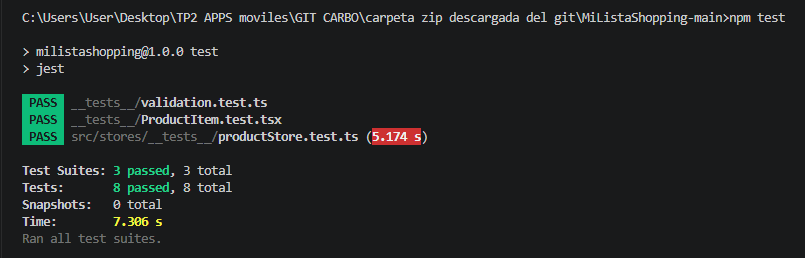
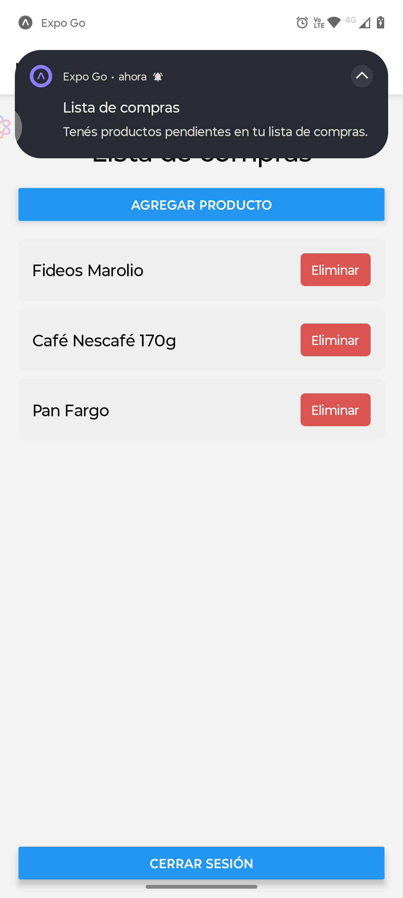

# MiListaShopping

Aplicación móvil desarrollada con **React Native + Expo + TypeScript** para gestionar una lista de compras.

Este proyecto corresponde a la evolución del trabajo práctico anterior, incorporando acceso a recursos nativos del dispositivo, manejo de permisos y estado global con Zustand.

## Funcionalidades

La aplicación permite:

- Registrar e iniciar sesión.
- Agregar productos a una lista de compras.
- Eliminar productos.
- Tomar una fotografía con la cámara.
- Seleccionar una imagen desde la galería.
- Obtener la ubicación actual mediante GPS.
- Seleccionar un contacto del teléfono como proveedor.
- Crear un recordatorio en el calendario asociado a un producto.
- Mostrar una notificación local luego de agregar un producto.
- Mantener la lista de productos mediante estado global con Zustand.
- Persistir los productos utilizando AsyncStorage.

## Recursos nativos utilizados

### Cámara

Se utiliza:

```text
expo-camera
```

Permite tomar una fotografía directamente desde la aplicación y asociarla al producto.

### Galería

Se utiliza:

```text
expo-image-picker
```

Permite seleccionar una imagen existente en el teléfono.

### Ubicación

Se utiliza:

```text
expo-location
```

La aplicación solicita permiso de ubicación y obtiene las coordenadas actuales del dispositivo.

Las coordenadas quedan asociadas al producto.

### Contactos

Se utiliza:

```text
expo-contacts
```

La aplicación permite seleccionar un contacto del teléfono y utilizarlo como proveedor del producto.

Se almacena, cuando está disponible:

- nombre
- teléfono
- correo electrónico

### Calendario

Se utiliza:

```text
expo-calendar
```

La aplicación permite crear un evento en el calendario del dispositivo asociado al producto.

Por ejemplo:

```text
Comprar Pan
```

El evento se crea para 24 horas después y tiene una duración de 30 minutos.

Debido a que `expo-calendar` requiere funcionalidad nativa no disponible en Expo Go para esta configuración, la aplicación se ejecuta mediante una **development build de Expo**.

### Notificaciones

Se utiliza:

```text
expo-notifications
```

Luego de agregar un producto se programa una notificación local recordando revisar la lista de compras.

## Manejo de permisos

La aplicación solicita los permisos necesarios en tiempo de ejecución.

Los recursos que requieren permisos son:

- Cámara
- Galería
- Ubicación
- Contactos
- Calendario
- Notificaciones

Si el permiso es rechazado, se muestra un mensaje informando que el recurso no puede utilizarse.

## Estado global

Para manejar la lista de productos se utiliza:

```text
Zustand
```

El store principal se encuentra en:

```text
src/stores/productStore.ts
```

El estado contiene la lista de productos y las siguientes acciones:

```text
addProduct
removeProduct
updateProduct
```

La persistencia se realiza mediante:

```text
zustand/middleware
AsyncStorage
```

De esta manera la lista de productos puede mantenerse almacenada localmente.

## Datos asociados a un producto

Un producto puede contener:

```text
Nombre
Imagen
Latitud
Longitud
Proveedor
Teléfono
Email
Estado del recordatorio de calendario
```

Ejemplo:

```text
Pan

Ubicación:
-32.xxxxxx, -60.xxxxxx

Proveedor:
Nombre del proveedor
Tel: ...

Recordatorio:
Creado en calendario
```

## Instalación

Instalar las dependencias:

```bash
npm install
```

En caso de utilizar una instalación limpia del proyecto también puede utilizarse:

```bash
npm ci
```

## Ejecución

La aplicación utiliza una **Expo Development Build**.

Para iniciar Metro:

```bash
npx expo start --dev-client
```

En caso de necesitar conexión mediante túnel:

```cmd
set NODE_PATH=C:\Users\User\AppData\Roaming\npm\node_modules
npx expo start --dev-client --tunnel
```

Luego se abre la aplicación **MiListaShopping** instalada en el dispositivo Android.

## Development Build

La development build fue generada utilizando **EAS Build**.

Perfil utilizado:

```text
development
```

Comando:

```bash
npx eas-cli@latest build --platform android --profile development
```

Esto genera un APK de desarrollo que incluye los módulos nativos necesarios para utilizar recursos como `expo-calendar`.

## Tests

El proyecto utiliza:

```text
Jest
React Native Testing Library
```

Para ejecutar las pruebas:

```bash
npm test
```

Resultado obtenido:

```text
Test Suites: 3 passed, 3 total
Tests:       8 passed, 8 total
Snapshots:   0 total
```

Se prueban:

- Validaciones.
- Componente ProductItem.
- Store de Zustand.
- Alta de productos.
- Eliminación de productos.
- Actualización de productos.


## Estructura principal

```text
src/
├── screens/
│   ├── HomeScreen.tsx
│   └── AddProductScreen.tsx
│
└── stores/
    ├── productStore.ts
    └── __tests__/
        └── productStore.test.ts
```

## Tecnologías utilizadas

- React Native
- Expo
- TypeScript
- Zustand
- AsyncStorage
- Expo Camera
- Expo Image Picker
- Expo Location
- Expo Contacts
- Expo Calendar
- Expo Notifications
- Jest
- React Native Testing Library
- EAS Build


## Prueba en dispositivo real

La aplicación fue probada en un dispositivo Android físico.

Se verificó correctamente:

- toma de fotografías,
- selección desde galería,
- ubicación GPS,
- selección de contactos,
- creación real de eventos en el calendario,
- notificaciones,
- persistencia de productos,
- estado global con Zustand.


## Video demostrativo

La entrega incluye un video breve donde se demuestra el funcionamiento de los principales recursos implementados.

Video de demostración de la aplicación:

[Ver video en YouTube](https://youtube.com/shorts/ze6sFlmhESg?si=ZnfpmaL_znZY2BWD)


## Evidencias

### Tests



### Notificación local

La notificación local fue verificada en el dispositivo Android físico.




## Autor

Gonzalo Carbo     